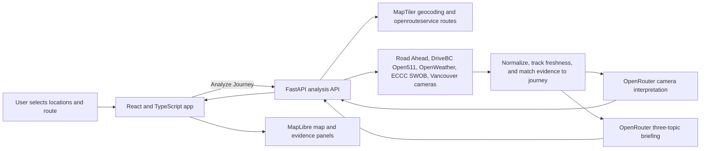

# RouteLens AI

**A source-grounded briefing for the drive into Vancouver.**

RouteLens AI brings public road, weather, and camera evidence together around a journey you have already planned. It helps answer **“What should I know before I leave?”** with a map, current destination context, and a concise AI Journey Briefing. It complements navigation apps; it does not provide turn-by-turn directions or choose the best route.

> **Datathon MVP:** Human accepted and implementation-complete through Phase 10. This is a locally run, desktop-oriented web application for driving journeys with a destination inside the City of Vancouver.

## Demo

> **Demo video:** _Placeholder — add an approved demo video link._

<!-- TODO: Replace the demo video placeholder after adding the approved video. -->

<details>
<summary>Optional application screenshot</summary>

_Placeholder — add a project screenshot when one is available._

<!-- TODO: Add an approved screenshot and concise alt text. -->

</details>

## What the MVP does

1. Choose an origin and a destination in Vancouver using place search.
2. Request approximate driving-route candidates and explicitly select the one closest to the journey you intend to take.
3. Select **Analyze Journey** to gather the available route and destination evidence.
4. Review the map and supporting panels, then read the source-grounded AI Journey Briefing.

The briefing has three fixed topics:

- **Camera and weather:** describes visible conditions at the selected destination-area camera and compares them with current or forecast weather only when the evidence is sufficiently close in place and time.
- **Destination weather:** summarizes available current and near-term weather, with nearby ECCC station measurements kept distinct from OpenWeather conditions and forecasts.
- **Closest relevant construction:** describes one selected Vancouver Road Ahead construction finding, prioritizing direct route overlap before proximity and distinguishing nearby events from route overlap.

Each topic can report that evidence is unavailable or insufficient. AI text is an interpretation of the evidence selected by the application, not an authoritative observation. The map and supporting panels also show route context such as municipal road events and regional DriveBC Open511 events; those are separate from the three briefing topics.

## Architecture and data flow



The React/Vite frontend sends application requests to the local FastAPI backend. The backend calls external providers, normalizes source responses, tracks source status and timestamps, filters journey evidence, and makes AI requests. Provider credentials stay in the backend environment; only the MapTiler key needed by the browser map is exposed through Vite. Camera images are handled as current frames with a short-lived cache, not as a historical image archive.

## Technology and data sources

| Area | Implemented technology or source | Role |
| --- | --- | --- |
| Web app | React, TypeScript, Vite, Tailwind CSS | Journey inputs, analysis state, and evidence panels |
| Map | MapLibre GL JS with MapTiler | Vancouver basemap, geocoding, and place search |
| API | Python, FastAPI, Pydantic, httpx, Shapely | Provider access, validation, normalization, and geographic relevance |
| Driving routes | openrouteservice | Approximate route candidates for explicit user selection |
| Municipal road data | City of Vancouver Road Ahead | Construction and road closures |
| Regional road data | DriveBC Open511 | Regional road events and route-relevant findings |
| Weather | OpenWeather and ECCC GeoMet/SWOB | Current/near-term weather and measured station observations |
| Camera data | City of Vancouver traffic-camera catalogue and linked views | Destination-area imagery and camera evidence |
| AI | OpenRouter with Google Gemma 4 31B Instruct | Structured camera interpretation and the three-topic briefing |

## Local setup

You will need Python 3.10 or newer, Node.js with npm, and provider credentials for the integrations you want to use. The application runs as separate local backend and frontend development servers.

1. Create a root `.env` file from the template and add your own credentials. Do not commit `.env`.

   ```bash
   cp .env.example .env
   ```

   The implemented provider variables are:

   | Variable | Used for |
   | --- | --- |
   | `MAPTILER_API_KEY` | Place search and map style/resources |
   | `OPENROUTESERVICE_API_KEY` | Driving-route candidates |
   | `OPENWEATHER_API_KEY` | Current and near-term weather |
   | `OPENROUTER_API_KEY` | Camera interpretation and AI briefing |

   The backend also accepts optional settings `OPENWEATHER_DAILY_REQUEST_LIMIT`, `SWOB_BBOX`, `SWOB_CACHE_TTL_SECONDS`, and `CAMERA_IMAGE_CACHE_TTL_SECONDS`. ECCC SWOB and DriveBC Open511 do not require credentials in the current implementation. Transit is deferred and its template key is not used by the MVP. The AI model is configured in the backend; the model identifier is not an environment setting.

2. Install backend dependencies from the repository root:

   ```bash
   python3 -m venv backend/.venv
   backend/.venv/bin/python -m pip install -e "backend[dev]"
   ```

3. Install frontend dependencies:

   ```bash
   npm --prefix frontend install
   ```

4. Start the API in one terminal from the repository root:

   ```bash
   backend/.venv/bin/uvicorn app.main:app --app-dir backend --reload --port 8000
   ```

5. Start the frontend in a second terminal:

   ```bash
   cd frontend
   npm run dev
   ```

   Open the local URL printed by Vite (normally `http://localhost:5173`). Vite proxies `/api` requests to the backend at `http://localhost:8000`.

## Data credits and licensing

The application labels its evidence sources and displays the ECCC attribution. This README credits the providers below. When reusing data, follow the terms that apply to the specific dataset, API plan, and asset:

- **City of Vancouver Road Ahead and camera catalogue metadata:** “Contains information licensed under the [Open Government Licence – Vancouver](https://opendata.vancouver.ca/pages/help/).” The licence for metadata does not by itself establish reuse rights for separately linked camera images. Camera imagery has distinct terms and rights considerations.
- **DriveBC Open511:** “Contains information licensed under the [Open Government Licence – British Columbia](https://pub.data.gov.bc.ca/license/OGL-vbc2.0.pdf). Source: DriveBC Open511 (Government of British Columbia).”
- **Environment and Climate Change Canada GeoMet/SWOB:** “Contains information licensed under the [Open Government Licence – Canada](https://open.canada.ca/en/open-government-licence-canada). Source: Environment and Climate Change Canada GeoMet/SWOB.”
- **OpenWeather:** Visible attribution is required; use **“Weather data © OpenWeather”** with a link to [OpenWeather](https://openweathermap.org/) and follow the current API subscription terms.
- **MapTiler and openrouteservice:** These provide map/geocoding and routing services; follow their current terms and attribution requirements. The rendered map also presents its provider/source attribution.

This portfolio MVP is not a legal determination of data or image rights. Review current provider terms before redistribution, public deployment, or commercial use. See [`docs/data-licensing-and-commercialization.md`](docs/data-licensing-and-commercialization.md) for the project's licensing notes.

## Scope and limitations

- Supported journeys are driving journeys into the City of Vancouver. Origins may be elsewhere in the surrounding region; destinations outside Vancouver and journeys out of Vancouver are unsupported.
- Route candidates are approximate context, not navigation directions, an ETA, or a guarantee that the route matches another navigation service.
- Camera coverage is limited to available Vancouver views near the selected destination. A camera view is local evidence, not a description of the whole route or destination, and AI interpretation can be uncertain.
- Data sources refresh on different schedules and may be missing, stale, delayed, or unavailable. The UI reports source status and freshness where available; a missing source does not mean conditions are clear.
- Weather observations, forecasts, and camera appearance represent different kinds of evidence and should not be treated as interchangeable.

## MVP and future ideas

**Implemented MVP:** driving-route selection; Vancouver destination validation; interactive map; municipal and regional road context; destination camera views and structured camera interpretation; destination weather from OpenWeather and ECCC/SWOB; and the source-grounded three-topic AI Journey Briefing.

**Deferred or future work:** transit and GTFS alerts, DriveBC cameras, journeys whose destination is outside Vancouver, richer timeline and cross-source analysis, and further integration/presentation hardening. These are not current MVP capabilities.

## Project notes

- [Application specification](APP_SPEC.md)
- [Current project state](PROJECT_STATE.md)
- [Implementation plan](docs/implementation-plan.md)
- [License](LICENSE)

Automated tests and fixtures are maintained in `backend/tests/`, `frontend/tests/`, and `fixtures/`.
